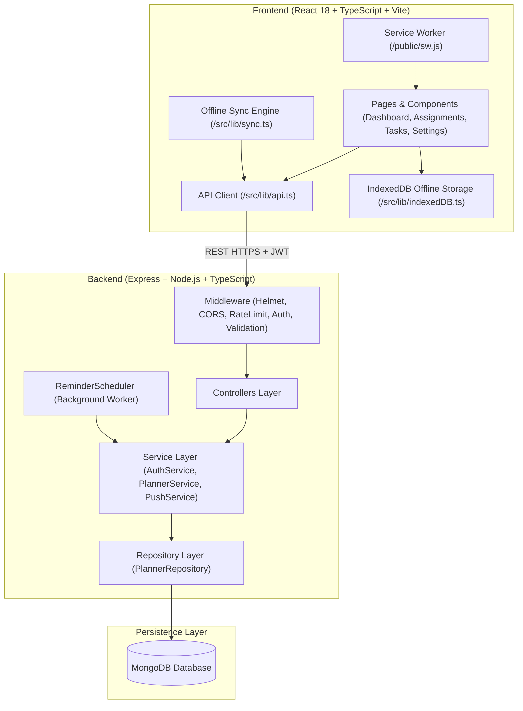
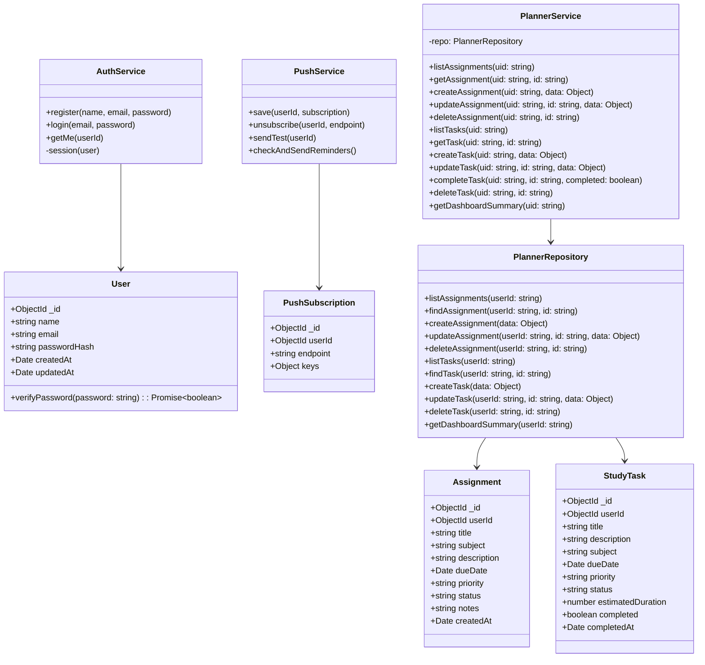
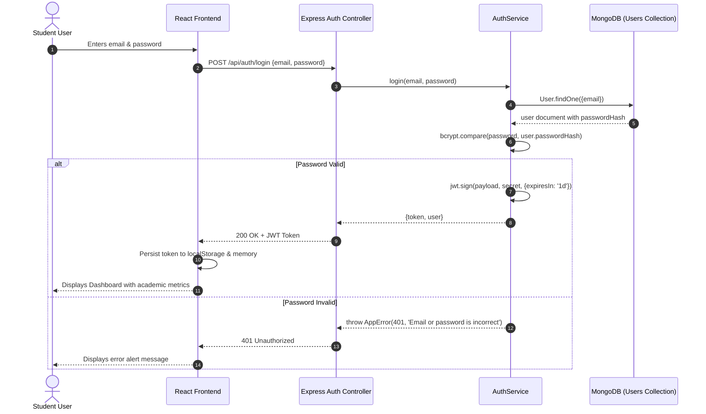
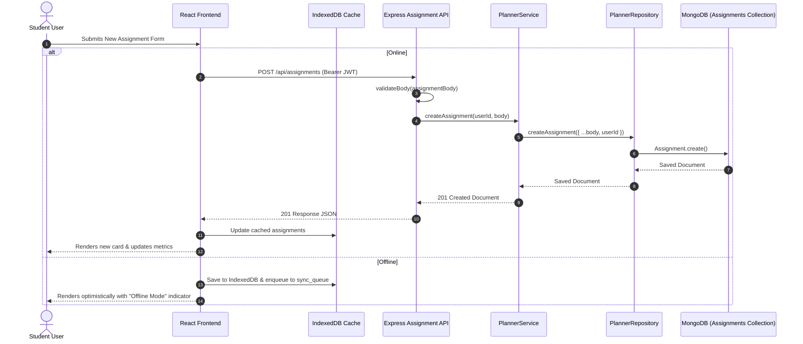

# Architecture & Design Patterns — Student Planner

## 1. System Architecture Diagram

---

## 2. UML Class Diagram

---

## 3. UML Sequence Diagrams

### 3.1 Authentication Workflow (Login)

### 3.2 Assignment Creation Workflow

---

## 4. Design Patterns Implemented

1. **Repository Pattern (`PlannerRepository.ts`)**:
   - Isolates MongoDB/Mongoose ORM queries from business logic. Enables mock testing without requiring a live database connection.

2. **Service Layer Pattern (`PlannerService.ts`, `AuthService.ts`, `PushService.ts`)**:
   - Encapsulates business validation rules, user ownership validation, and notification coordination.

3. **Controller Pattern (`controllers.ts`)**:
   - Translates HTTP inputs (body, params, userId) into service invocations and returns formatted JSON status codes.

4. **Middleware Pattern (`auth.ts`, `validate.ts`, `errorHandler.ts`)**:
   - Centralizes token verification, Zod schema validation, and unified JSON error handling with safe responses.

5. **Observer / Background Worker Pattern (`ReminderScheduler.ts`)**:
   - Asynchronously runs in the background checking for upcoming assignments and triggering Web Push alerts.
