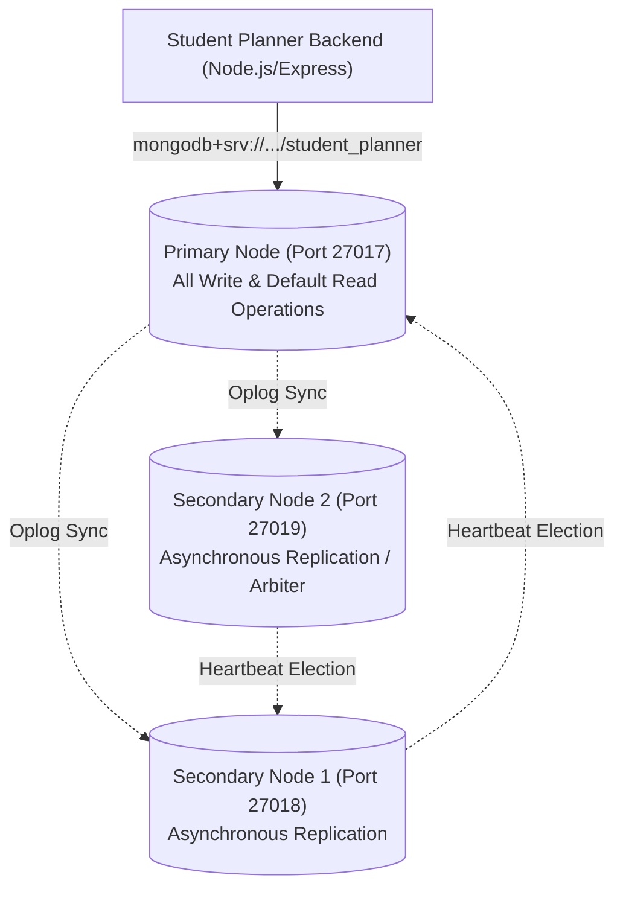
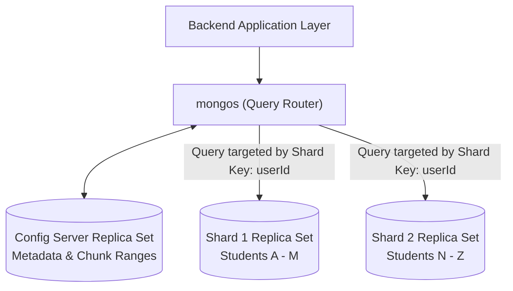

# Additional Features (Bonus Marks): MongoDB Database Replication and Scaling

This document provides the full technical design and configuration specifications for **MongoDB Database Replication and Horizontal Scaling (Sharding)** in enterprise production, addressing the **Task 10 (Bonus Marks)** requirement of the IA730001 rubric.

---

## 1. MongoDB Replica Set Architecture (High Availability & Fault Tolerance)

### 1.1 Architecture Overview
A MongoDB Replica Set consists of a cluster of `mongod` instances hosting the same dataset, providing **high availability, automated failover, and data redundancy**.



### 1.2 Replication Mechanics
1. **Oplog (Operations Log):**
   - All write operations (`createAssignment`, `updateTask`, `register`) executed on the **Primary node** are recorded in its special capped collection: `local.oplog.rs`.
   - The **Secondary nodes** continuously tail the Primary's oplog and apply these operations asynchronously to their local dataset.
2. **Automated Heartbeats & Failover Election:**
   - Every node in the replica set exchanges heartbeat pings every 2 seconds.
   - If the Primary becomes unreachable for more than 10 seconds, the eligible Secondary nodes hold an election using the Raft-like consensus algorithm. The Secondary node with the most recent oplog is automatically promoted to Primary without application downtime.
3. **Application Connection String:**
   ```env
   MONGODB_URI=mongodb://node1.example.com:27017,node2.example.com:27017,node3.example.com:27017/student_planner?replicaSet=rs0&readPreference=secondaryPreferred&w=majority
   ```
   - `w=majority`: Guarantees writes are acknowledged by the majority of nodes before returning success (strong consistency).
   - `readPreference=secondaryPreferred`: Offloads heavy read queries (such as calculating large dashboard analytics across thousands of students) to Secondary replicas, preserving Primary write throughput.

---

## 2. Horizontal Scaling via Sharding (Large-Scale Enterprise Deployment)

### 2.1 Sharded Cluster Architecture



### 2.2 Shard Key Selection: `{ userId: "hashed" }`
- **Optimal Key:** `userId` using a hashed index:
  ```javascript
  sh.shardCollection("student_planner.assignments", { "userId": "hashed" });
  sh.shardCollection("student_planner.studytasks", { "userId": "hashed" });
  ```
- **Architectural Rationale:**
  - **Uniform Data Distribution:** Prevents "hot-spotting" where all new assignments cluster on a single physical server.
  - **Targeted Routed Queries:** Since every query in `PlannerRepository.ts` already filters by `{ userId }`, the `mongos` query router sends queries directly to the exact shard holding that student's records, preventing expensive cluster-wide broadcast (scatter-gather) queries.

---

## 3. MongoDB Cloud Atlas Deployment Steps (Cloud Configuration Reference)

### Step 1: Provision Multi-Region Replica Set on MongoDB Atlas
1. Sign in to MongoDB Cloud Atlas and select **Create Cluster**.
2. Select **Dedicated M10+ Tier** across 3 Availability Zones (e.g., AWS `ap-southeast-2` Sydney / Auckland edge).
3. Select **3-Node Replica Set** (1 Primary, 2 Secondaries).

### Step 2: Configure Network Access & VPC Peering
1. Add backend server IP address to Atlas IP Access List (`0.0.0.0/0` with secure SCRAM-SHA-256 database user authentication or private AWS VPC peering).
2. Create dedicated database user `student_planner_admin` with `readWrite` role.

### Step 3: Connect the Application
In `student-planner-practice/backend/.env`:
```env
MONGODB_URI=mongodb+srv://student_planner_admin:<PASSWORD>@cluster0.abcde.mongodb.net/student_planner?retryWrites=true&w=majority
```
Restart backend server:
```powershell
npm run dev
```
Mongoose automatically detects the replica set topology, enables automatic connection retries, and honors majority write guarantees.
