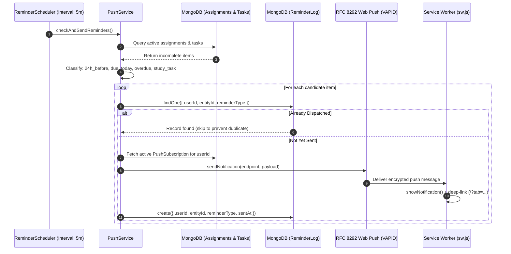

# Automatic Web Push Reminder Scheduler & Viva Demonstration Guide

## IA730001: Task 05 & Task 10 — Genuine Web Push Reminder Architecture

---

## 1. Architectural Overview & Workflow Diagram

---

## 2. Core Technical Requirements Implemented

1. **24 Hours Before Deadline**:
   - Queries assignments where `dueDate` is between `now` and `now + 24 hours`.
   - Notification Title: `⏳ Due in 24 Hours: [Title]`
   - Deep-link data payload: `/?tab=assignments`

2. **Due Date (Due Today)**:
   - Queries assignments where `dueDate` falls within today's calendar boundaries `[startOfToday, endOfToday]`.
   - Notification Title: `📅 Assignment Due Today: [Title]`

3. **Overdue Reminder**:
   - Queries incomplete assignments where `dueDate < startOfToday`.
   - Notification Title: `⚠️ Overdue Assignment: [Title]`

4. **Important Study Tasks**:
   - Queries incomplete tasks where `dueDate <= now + 24 hours`.
   - Notification Title: `📚 Study Task Reminder: [Title]`
   - Deep-link data payload: `/?tab=tasks`

5. **Zero Duplicate Notifications (Across Server Restarts)**:
   - Implemented `ReminderLog` Mongoose model with a compound unique index:
     `{ userId: 1, entityId: 1, reminderType: 1 }`
   - Even if the backend server restarts 100 times, the log guarantees each reminder category for a specific item is dispatched **exactly once**.

6. **Strict Multi-Tenant Scoping**:
   - Notifications are matched only to the `PushSubscription` documents corresponding to `item.userId`. One student never receives another student's deadline alerts.

7. **Completed & Deleted Items Excluded**:
   - Assignments with status `Completed` or tasks with `completed: true` are filtered out directly in MongoDB queries.

8. **Notification Click Navigation**:
   - The Service Worker (`public/sw.js`) reads `event.notification.data.url`.
   - Clicking the desktop alert focuses the Student Planner browser tab and automatically switches to the relevant tab (`assignments` or `tasks`) via `URLSearchParams` on mount.

---

## 3. How to Demonstrate Automatic Reminders in Your Viva (Oral Exam)

Examiners usually don't want to wait 24 hours to see a reminder. Here is the **step-by-step viva demonstration procedure**:

### Step 1: Open the Application Locally
1. Ensure both backend and frontend are running:
   - Backend on `http://localhost:4000`
   - Frontend on `http://localhost:5173`
2. Open Google Chrome or Microsoft Edge and navigate to **`http://localhost:5173`**.

### Step 2: Subscribe to Web Push
1. Navigate to **Settings & Security** (or click the **"Enable Alerts"** pill in the top header).
2. Click **"Enable Web Push Alerts"**.
3. In the browser permission pop-up, click **"Allow"**.
4. The status badge will change to **"Subscribed & Active"**.

### Step 3: Create a Test Assignment with an Imminent / Due Today Deadline
1. Go to the **Assignments** tab.
2. Click **"+ New Assignment"**.
3. Fill in:
   - **Title**: `Viva Demo - Operating Systems Lab`
   - **Subject**: `COMP702`
   - **Due Date**: Select **Today's date** (or tomorrow's date for 24h test).
   - **Priority**: `High`
4. Click **"Create Assignment"**.

### Step 4: Demonstrate the Trigger
1. In the **Settings & Security** tab, you have two verification tools:
   - **"Send Test Alert"**: Verifies direct Web Push pipe delivery.
   - **"Scan & Dispatch Deadlines Now"**: Directly invokes `POST /api/notifications/trigger-reminders`, which triggers the exact logic run by the background scheduler.
2. Click **"Scan & Dispatch Deadlines Now"**.
3. **Observation**: A native operating system notification pops up in the bottom-right corner:
   > **📅 Assignment Due Today: Viva Demo - Operating Systems Lab**  
   > *"Viva Demo - Operating Systems Lab" (COMP702) is due today. Ensure all files are uploaded!*
4. Click the notification: Notice that the browser brings the window to focus and routes directly to the Assignments list.

### Step 5: Demonstrate Idempotency & Duplicate Prevention
1. Click **"Scan & Dispatch Deadlines Now"** a second time.
2. **Observation**: The status reads: `Checked reminders: 0 dispatched.`
3. **Viva Explanation**: Explain to the examiner that MongoDB's `ReminderLog` recorded the dispatch, preventing repetitive spamming even if the scheduler runs every 5 minutes or the server restarts.
